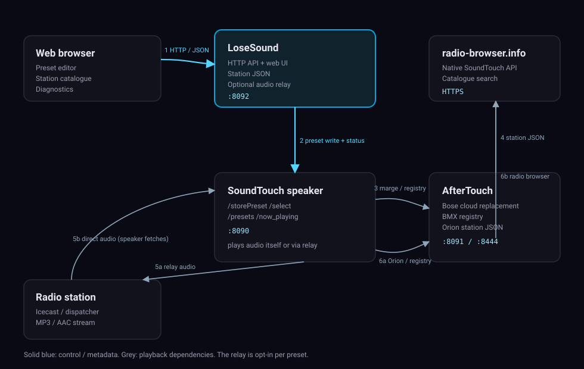

# LoseSound

[](https://github.com/osxdoc/LoseSound/actions/workflows/ci.yml)
[](https://github.com/osxdoc/LoseSound/releases)
[](LICENSE)
[](https://github.com/osxdoc/LoseSound/pkgs/container/losesound)

LoseSound is a small, self-hosted web UI for **preset buttons 1-6** on Bose SoundTouch
speakers. It manages stations, writes presets through the speaker's local API and keeps a
stream relay for stations that need one. It works together with
[AfterTouch](https://github.com/gesellix/Bose-SoundTouch), the local replacement for the Bose
cloud.

> Bose shut down the SoundTouch cloud on **6 May 2026**. Presets, browsing and pairing no longer
> work through Bose. AfterTouch restores that locally. LoseSound adds a station catalogue, a
> preset editor and diagnostics on top.

## Why this project exists

The SoundTouch API looks simple, but one detail trips almost everyone up:

**A preset for internet radio must point at a station description (JSON), not at the audio
stream.** The speaker fetches the preset location and expects a `BmxPlaybackResponse`; if it gets
raw audio it silently plays nothing. That is why "just paste the stream URL" failed in older
versions of LoseSound (and why a proxy was needed at all).

LoseSound implements the three supported ways around this and lets you choose per preset:

| Mode | What the speaker fetches | Audio goes through LoseSound | Best for |
| --- | --- | --- | --- |
| `relay` | a JSON description served by LoseSound | **yes** (buffered) | tokenised/redirecting streams, debugging |
| `speaker` | a JSON description served by LoseSound | no | stable direct stream URLs |
| `radioBrowser` | `radio-browser.info` directly | no | stations from the catalogue |
| `orion` | AfterTouch's Orion station endpoint | no | AfterTouch 0.99+, host-independent presets |
| `auto` | uses the recommendation from the last stream check | depends | hands-off default |

See [docs/MODES.md](docs/MODES.md) for the technical details.

## Features

- Edit all six preset buttons from the browser, including the playback mode per slot.
- Station catalogue backed by [radio-browser.info](https://www.radio-browser.info), with artwork.
- Optional audio relay with ring buffer, prebuffering, real-time pacing, reconnect logic and
  detailed stream statistics.
- Read-only diagnostics (`scripts/verify.py`) and an in-app setup check that detects the usual
  AfterTouch traps (old version, dead `/marge` URL, missing radio sources).
- Optional API token for write actions.
- Small, dependency-free Python service; multi-arch container image (amd64/arm64).

## Architecture



| Component | Default port | Purpose |
| --- | --- | --- |
| AfterTouch (`soundtouch-service`) | 8091 / 8444 | Replaces the Bose cloud, owns the BMX service registry |
| LoseSound (`preset-proxy`) | 8092 | Web UI, preset writes, station descriptions, optional relay |
| SoundTouch speaker | 8090 | Local API used for `/storePreset`, `/select`, `/now_playing` |

## Requirements

- Docker with the Compose plugin (v2)
- A SoundTouch speaker on the same LAN
- AfterTouch running on a host with a stable LAN address
- Internet access for the catalogue (radio-browser.info) and for stations the speaker plays directly

## Quick start

```bash
git clone https://github.com/osxdoc/LoseSound.git
cd LoseSound
python3 scripts/setup.py            # discovers the speaker, writes .env, starts Docker
```

If discovery fails:

```bash
python3 scripts/setup.py --speaker-ip 192.168.1.50
```

Then open `http://<docker-host>:8092`. The setup banner explains what is still missing.

### Install from the published image

```bash
cp .env.example .env
# edit SERVICE_HOST and SPEAKER_IP
docker compose pull
docker compose up -d
```

`docker-compose.yml` uses `ghcr.io/osxdoc/losesound:${LOSESOUND_VERSION:-latest}` and keeps a
`build:` section for local development. AfterTouch is pinned to a tested release via
`SOUNDTOUCH_VERSION` (default `0.138.1`).

## Preset modes in practice

- Use **Direct** (`speaker`) when the station URL returns audio directly and does not rely on a
  short-lived token.
- Use **Relay** for ARD/Regiocast-style dispatchers that redirect to tokenised edge URLs.
- Use **Radio Browser** for stations added from the catalogue; no local service is involved in
  playback, but the speaker must handle the station URL itself.
- Use **AfterTouch** after upgrading AfterTouch to 0.99 or newer; presets then use a relative
  station location and survive address changes.

The **Check stream** button follows redirects, reports the content type and recommends a mode.
Existing presets must be saved again after changing a mode.

## Configuration

All settings can be supplied through `.env` (see [.env.example](.env.example)). Values in the web
UI are stored in the container volume and take precedence over the environment defaults.

| Variable | Default | Description |
| --- | --- | --- |
| `SERVICE_HOST` | – | LAN address of the Docker host (required) |
| `SPEAKER_IP` | – | Speaker used for preset writes (required) |
| `SPEAKER_IPS` | `SPEAKER_IP` | Speakers checked in the UI and setup diagnostics |
| `SPEAKER_PORT` | `8090` | Speaker HTTP API port |
| `PROXY_PORT` | `8092` | Published LoseSound port |
| `AFTERTOUCH_HTTP_PORT` | `8091` | AfterTouch HTTP port |
| `AFTERTOUCH_HTTPS_PORT` | `8444` | AfterTouch HTTPS port (DNS migration) |
| `BASE_URL` | derived | URL the speaker uses to reach the station descriptions |
| `BUFFER_SECONDS` | `3` | Relay ring buffer |
| `PREBUFFER_SECONDS` | `2` | Audio buffered before the first byte is sent |
| `BITRATE_KBPS` | `128` | Fallback pacing for the relay |
| `RECONNECT_BACKOFF_MS` | `250,500,1000,2000,3000` | Upstream reconnect backoff |
| `AUDIO_PROXY_ENABLED` | `1` | Seeds the default mode (`0` → `speaker`) |
| `DEFAULT_PRESET_MODE` | `auto` | Default mode for new presets |
| `API_TOKEN` | empty | Optional bearer token for POST/DELETE |
| `RADIO_BROWSER_BASE_URL` | `https://de1.api.radio-browser.info` | Catalogue API |
| `LOG_STREAM_CHUNKS` | `0` | Verbose per-chunk stream logging |
| `LOG_URL_QUERY` | `0` | Log full URLs including stream tokens |
| `NET_FORCE_IPV4` | `1` | Prefer IPv4 for outbound requests (helps on networks with broken IPv6) |
| `SOUNDTOUCH_VERSION` | `0.138.1` | AfterTouch image tag |
| `LOSESOUND_VERSION` | `latest` | LoseSound image tag |

## Diagnostics

```bash
python3 scripts/verify.py                 # reads .env
python3 scripts/verify.py --service-host 192.168.1.10 --speaker-ip 192.168.1.50
```

The script is read-only and checks the service, AfterTouch, the speaker, the BMX registry, every
preset location and every station description. Exit codes: `0` ok, `1` failed check, `2`
undecided/unreachable. In the web UI the same information appears as a banner with concrete hints.

## Upgrading

- LoseSound 1.0 migrates `config.json` automatically (`proxy` → `relay`, `direct` → `speaker`).
- Existing container volumes keep working; the container now runs as UID 10001. If the volume was
  created by an older image you may need
  `docker run --rm -v losesound_preset_proxy_data:/data busybox chown -R 10001:10001 /data`.
- AfterTouch upgrades and the required speaker re-migration are described in
  [docs/UPGRADING.md](docs/UPGRADING.md). Always back up the AfterTouch volume first.

## Troubleshooting

A few classics (details in [docs/TROUBLESHOOTING.md](docs/TROUBLESHOOTING.md)):

- **Preset plays nothing.** Check the mode. A raw stream URL as preset location can never work;
  save the slot again with Direct or Relay.
- **Setup says the marge URL answers 502.** AfterTouch before 0.99 did not serve `/marge`; update
  AfterTouch and migrate the speaker again with the plain base URL (no `/marge` suffix).
- **Radio sources disappear after a reboot.** They are registered from `Sources.xml` only at boot.
  Reboot the speaker, or send a `sourcesUpdated` notification.
- **Relay stutters.** Increase `BUFFER_SECONDS`, check the upstream with **Check stream**, or use
  Direct if the station URL is stable.

## Development

```bash
python3 -m venv .venv
.venv/bin/pip install -e ".[dev]"
.venv/bin/python -m pytest
.venv/bin/python -m ruff check .
```

Project layout:

```
src/losesound/          Python service (stdlib only)
src/losesound/static/   Web UI (plain HTML/CSS/JS, no build step)
scripts/setup.py        Interactive installer
scripts/verify.py       Read-only health check
docs/                   Architecture, modes, troubleshooting, upgrading
tests/                  pytest suite with fake speaker/AfterTouch/upstream servers
```

Environment for a local run: `PYTHONPATH=src CONFIG_PATH=./data/config.json python3 -m losesound`.

## Security

LoseSound is designed for a trusted home LAN. Write actions can be protected with `API_TOKEN`;
reads stay open. Do not expose the port to the internet without a reverse proxy and authentication.
The container drops all capabilities, runs as a non-root user and uses `no-new-privileges`.

Please report vulnerabilities as described in [SECURITY.md](SECURITY.md).

## License and credits

MIT licensed, see [LICENSE](LICENSE).

- [AfterTouch / Bose-SoundTouch](https://github.com/gesellix/Bose-SoundTouch) by gesellix and
  contributors does the heavy lifting (cloud replacement, BMX registry, Orion endpoint).
- [SoundCork](https://github.com/deborahgu/soundcork) pioneered cloud emulation for SoundTouch.
- [radio-browser.info](https://www.radio-browser.info) provides the station catalogue and the
  native SoundTouch API.
- [SoundTouch Plus](https://github.com/thlucas1/homeassistantcomponent_soundtouchplus) documents
  the undocumented speaker endpoints.

This project is not affiliated with Bose Corporation.

## Deutsch

LoseSound ist eine kleine, selbst gehostete Weboberfläche für die **Preset-Tasten 1-6** eines Bose
SoundTouch. Es verwaltet Sender, schreibt Presets über die lokale Speaker-API und betreibt nur dann
einen Audio-Relay, wenn ein Stream ihn wirklich braucht. Voraussetzung ist
[AfterTouch](https://github.com/gesellix/Bose-SoundTouch) als lokaler Ersatz für die am 6. Mai 2026
abgeschaltete Bose-Cloud.

**Wichtig:** Ein Preset für Internetradio muss auf eine Senderbeschreibung (JSON) zeigen, nicht auf
die rohe Stream-URL. Der Speaker ruft die Location ab und erwartet ein `BmxPlaybackResponse`; bei
Audiodaten passiert nichts. Deshalb gibt es die Modi:

| Modus | Audio über LoseSound | Empfehlung |
| --- | --- | --- |
| `relay` | ja, gepuffert | tokenisierte/umgeleitete Streams |
| `speaker` | nein | stabile Direkt-URLs |
| `radioBrowser` | nein | Sender aus dem Katalog |
| `orion` | nein | AfterTouch 0.99+ |
| `auto` | je nach Prüfung | Standard |

Schnellstart:

```bash
git clone https://github.com/osxdoc/LoseSound.git
cd LoseSound
python3 scripts/setup.py
```

Danach `http://<docker-host>:8092` öffnen. Der Einrichtungsbanner zeigt fehlende Schritte an.
Diagnose: `python3 scripts/verify.py` (nur lesend). Details, Update- und Fehlerbehebungshinweise
stehen in [docs/](docs/).
